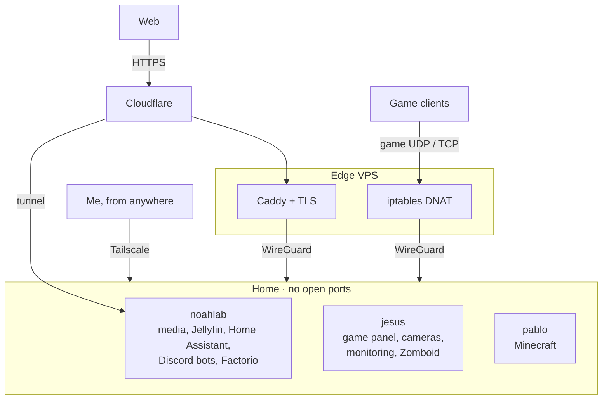

# MILKHAUS · homelab

This is everything I run at home. Three machines in my house and one small VPS, hosting
game servers for my friends, a movie site, my Discord bots, cameras, and a lot of
automation for the house. It started because I just wanted a personal stream thing and
kinda got out of hand lol.

Every compose file, config and script in here is copied from the machine it actually
runs on. The only difference is the passwords got pulled out on the way. The public side
of all this is **[milkhaus.net](https://milkhaus.net)**.

## How it's wired

My router forwards zero ports. Websites come in through Caddy on the VPS or a
Cloudflare tunnel, game traffic gets forwarded by the VPS and rides WireGuard home, and
I get in over Tailscale. The torrent client has its own VPN that only exists inside its
container, so it can't leak onto anything else. The full picture is in
[docs/architecture.md](docs/architecture.md).

## The boxes

noahlab, jesus and pablo are just the hostnames of the three home machines. The VPS is
a small rented server that takes the public traffic so my home IP stays hidden.

| | Hardware | What it does |
|---|---|---|
| **noahlab** | Ryzen 7 2700X · GTX 1660 SUPER · 32 GB · 14 TB media drive + 1 TB backup SSD | Media downloads, Jellyfin with GPU transcoding, Home Assistant, the Discord bots, Factorio |
| **jesus** | Ryzen 9 3900X · GTX 970 · 32 GB | Game panel, the cameras, Prometheus + Grafana, my fantasy football and assistant bots, Zomboid |
| **pablo** | Ryzen 5 5600X · RX 560 · 16 GB | Minecraft (Java + Bedrock) |
| **VPS** | 1 vCPU | Caddy, game port forwarding, the static sites |

The home boxes run Ubuntu 24.04 and Docker. The VPS just runs Caddy and WireGuard.

## What's in here

Each folder has a short README: what it is, which box it's on, and anything worth
knowing before you copy it.

**Media**
- [`services/media`](services/media/): request a movie or show and it downloads behind a VPN and lands in Jellyfin
- [`services/jellyfin`](services/jellyfin/): the streaming server, with GPU transcoding and 84 free live TV channels
- [`services/filebrowser`](services/filebrowser/): grab a file off the media drive from anywhere

**Games**
- [`services/pterodactyl`](services/pterodactyl/): the game panel, plus the scripts that keep Factorio updated
- [`services/pzstats`](services/pzstats/): live stats page for the Zomboid server at [pz.milkhaus.net](https://pz.milkhaus.net)

**House**
- [`services/home-assistant`](services/home-assistant/): heating and lights that follow who's home, doorbell snapshots, chore reminders
- [`services/frigate`](services/frigate/): nine cameras with person and cat detection and a week of recordings
- [`services/donetick`](services/donetick/): the household chore chart

**Discord and the web**
- [`services/igembed`](services/igembed/) · [`services/xembed`](services/xembed/): make Instagram and X links actually preview in Discord
- [`edge/`](edge/): the VPS side, Caddy and the game port forwarding

**Running the lab**
- [`services/monitoring`](services/monitoring/): Prometheus + Grafana, with dashboards built from Python so changes show up as a diff
- [`ops/`](ops/): nightly backups to a second drive, and alerts that message me when something's off
- [`virtual-desktop/`](virtual-desktop/): a desktop on a monitor-less server that I stream to my phone, with a browser scripts can use
- [`services/portmap`](services/portmap/): my cheat sheet of every port on every box
- [`services/xmrig`](services/xmrig/): a CPU miner that backs off when noahlab gets hot (off right now)
- [`tools/`](tools/): the scripts that keep this repo safe to be public

## Stuff I learned the hard way

Nothing works how you think it does, I promise. Most of what's in here exists because
something broke first:

- a `docker system prune` deleted the game panel's network, so now a timer puts it back
  ([what happened](docs/incidents.md#a-docker-prune-broke-every-game-server))
- the VPN's health check restarted the tunnel 579 times in one night
  ([what happened](docs/incidents.md#the-vpn-restarted-itself-579-times-in-a-night))
- Jellyfin making thumbnails starved the game servers, and the fix was the GPU decoder,
  not the encoder ([what happened](docs/incidents.md#jellyfin-thumbnails-starved-the-game-servers))
- one browser per fantasy league ran noahlab out of memory
  ([what happened](docs/incidents.md#too-many-browsers-ran-noahlab-out-of-memory))
- the nightly backup was quietly skipping the files that actually mattered
  ([what happened](docs/incidents.md#the-backup-skipped-the-files-that-mattered))

All eight write-ups are in [docs/incidents.md](docs/incidents.md).

## Keeping my passwords out of this

The live configs have real credentials in them, so nothing gets copied here by hand:

1. [`tools/sync-from-live.sh`](tools/sync-from-live.sh) copies the live files over from
   each box and swaps secrets for `${VAR}` placeholders, with `.env.example` files next
   to them.
2. [`tools/verify-no-leaks.sh`](tools/verify-no-leaks.sh) checks the result two ways. One
   pass looks for anything shaped like a credential. The other pulls my actual secrets
   from the live machines and makes sure none of them show up anywhere in the repo. If
   either one finds something, the sync fails.
3. CI runs the pattern check again plus [gitleaks](https://github.com/gitleaks/gitleaks)
   on every push, validates every compose file, and runs the scripts' tests.

## Related

- **[milkhaus.net](https://milkhaus.net)** has everything that's running and how to get in.
- **[Milkcat Nexus](https://discord.gg/b9fhFHp8FJ)** is my Discord server, for help,
  whitelists and media invites.
- **Teto** is my Discord bot. The code is private, but her policies and pricing are in
  [teto-zone](https://github.com/Milkhaus-tech/teto-zone) and you can add her from
  [milkhaus.net/teto](https://milkhaus.net/teto).

## License

[MIT](LICENSE). Take whatever you want. If it saves you a 3am debugging session, that's
the whole point.
