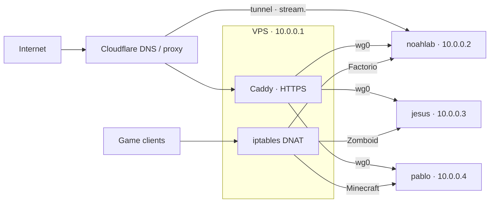

# Architecture

Three machines at home and one VPS. The home boxes are **noahlab**, **jesus** and
**pablo** (those are just their hostnames). None of them has a port open to the
internet. Everything public comes in through the VPS, a Cloudflare tunnel, or one
Tailscale Funnel for a bot's webhooks.

## The nodes

| | Hardware | WireGuard | Runs |
|---|---|---|---|
| **noahlab** | Ryzen 7 2700X (16 threads) · GTX 1660 SUPER · 32 GB · 1 TB NVMe, 14 TB HDD, 1 TB backup SSD | `10.0.0.2` | Media pipeline, Jellyfin, Home Assistant + Mosquitto + Matter, Pi-hole, Discord bots + their dashboards, link fixers, the Zomboid and Minecraft status pages, the main virtual desktop, Factorio |
| **jesus** | Ryzen 9 3900X (24 threads) · GTX 970 · 32 GB · 1 TB | `10.0.0.3` | Pterodactyl panel, Frigate, Prometheus + Grafana, my fantasy football bot and its desktops, my assistant bot, Project Zomboid |
| **pablo** | Ryzen 5 5600X (12 threads) · RX 560 · 16 GB · 250 GB | `10.0.0.4` | Minecraft (Java + Bedrock), and an Android container for a phone game bot |
| **VPS** | 1 vCPU | `10.0.0.1` | Caddy, game port forwarding, the static sites |

The home boxes run Ubuntu 24.04 with Docker, and all three are Pterodactyl nodes: the
panel is the web UI on jesus, and Wings (the agent that runs the game containers) runs
natively on each box. noahlab has the big drive, so anything that needs storage ends up
there, and the boxes share files over NFS (more below).

## How traffic gets in

There are five ways in, and they don't mix:

| Path | Carries |
|---|---|
| **Cloudflare tunnel** (`cloudflared` on noahlab) | Jellyfin, plus one Discord bot's web page. Jellyfin used to go through the VPS, but WireGuard decrypt on one vCPU topped out around 200 Mbps. The tunnel does ~270 on a single stream and keeps my home IP out of DNS. |
| **Edge WireGuard** (`wg0`, VPS ↔ each node) | Every other public site, plus game traffic |
| **Tailscale Funnel** (noahlab) | The donation and vote webhooks for my public Discord bot |
| **gluetun WireGuard** | Only exists inside the torrent container's network. Torrent traffic and the VPN provider's forwarded port. |
| **Tailscale** | How I get in. SSH, web UIs, Moonlight, monitoring. |

### Websites

HTTPS ends at Caddy on the VPS ([`edge/Caddyfile`](../edge/Caddyfile)), which proxies
over WireGuard to whichever node has the service:

| Site | Goes to |
|---|---|
| `request.` · `join.` · `files.` | noahlab: Jellyseerr (requests), jfa-go (invites), Filebrowser |
| `pz.` · `mc.` | noahlab: the Zomboid and Minecraft status pages |
| `ig.` · `x.` | noahlab: the Instagram and X link fixers |
| `stats.` (and `stats./manage`) | noahlab: my Discord bot's server stats dashboard and manager panel |
| `goodnod.` | noahlab: a side project |
| `panel.` | jesus: Pterodactyl panel |
| `node1.` · `jesus.` · `pablo.` | Wings API on each node, port 8090. This is how the panel talks to them, so it has to be public. Every call needs the node's token. |
| `milkhaus.net` and the other static sites | Served straight off the VPS |
| `stream.` · `miku.` | Not on the VPS at all. Cloudflare tunnel to noahlab (Jellyfin, and a Discord card game bot's page). |

### Game servers

Game traffic never touches Caddy. It's plain `iptables` DNAT on the VPS, saved with
`netfilter-persistent`:

| Game | Ports | Node |
|---|---|---|
| Factorio | UDP 34197 | noahlab |
| Project Zomboid | UDP 16261, 16262 | jesus |
| Minecraft Java | TCP 25565 | pablo |
| Minecraft Bedrock (Geyser) | UDP 19132 | pablo |

Things I learned the hard way here:

1. **The VPS provider has its own cloud firewall** in front of the VPS, and packets it
   drops never even show up in `tcpdump`. A new game port needs a rule there and a DNAT
   rule on the VPS. Test from a network that isn't yours.
2. **Game subdomains have to be grey cloud (DNS only).** Cloudflare's proxy only does
   HTTP(S), so an orange-cloud record just eats game UDP. Same reason SFTP on port
   2022 doesn't work from outside on any node; the panel's file manager is fine.
3. **Delete a DNAT rule with exactly the same flags it was added with.** Some of mine
   carry `-i enp1s0` and some don't. Leave one off and the delete fails, so the old rule
   keeps winning.

## Adding a node

A node needs three things before the panel can see it. Wings running isn't enough.

1. A Cloudflare record `<node>.milkhaus.net` pointing at the VPS (proxied). Do this
   **first**, or Caddy's certificate request fails and you get a 525 until the next reload.
2. A Caddy block for it proxying to `10.0.0.x:8090`.
3. A WireGuard peer on the VPS: `wg set wg0 peer <pubkey> allowed-ips 10.0.0.x/32`, then
   `wg-quick save wg0`.

Watch out for different `pterodactyl` user IDs across boxes (pablo's is different from
the other two), so `chown` after copying a server volume over. And don't copy CPU
pinning from a 24-thread box onto a 12-thread one; the server just won't start.

## Who shares what

| What | From → to | Why |
|---|---|---|
| Frigate recordings | noahlab `/mnt/media/frigate` → jesus (NFS) | jesus has the CPU for the cameras, noahlab has the space |
| Zomboid server files | jesus → noahlab (NFS, read-only) | the Zomboid stats page on noahlab reads the server logs |
| Minecraft server files | pablo → noahlab (NFS, read-write) | the Minecraft stats page reads them, and my Discord bot's whitelist command writes `whitelist.json` |

The game volumes get mounted on noahlab at the exact same path they have on their own
node, so the stats scripts didn't have to change.

## Exposure

| Ring | Examples | How it's exposed |
|---|---|---|
| Public | Jellyfin, Jellyseerr, panel, invites, files, status pages, link fixers, stats | Internet, through the VPS or the tunnel. Media accounts are invite-only. |
| Game | Zomboid, Factorio, Minecraft (whitelisted) | Internet, through VPS DNAT |
| Admin | Grafana, Prometheus, the *arr apps (Sonarr, Radarr and friends), qBittorrent, Frigate, Home Assistant, Sunshine | Not published anywhere public. I use them over Tailscale or the LAN. |
| Localhost only | Chromium's debug ports, the bots' manage APIs | Only the machine it runs on. The debug port gives full control of a logged-in browser, so it never leaves the machine. |

## Keeping games smooth

The rule is that games get their own cores and the busy stuff is kept off them.

| Node | Game cores | Kept off them |
|---|---|---|
| noahlab | Factorio on threads 10–15 | Jellyfin, qBittorrent, Sonarr, the link fixers and the stats pages are pinned to 0–9 |
| jesus | Zomboid on threads 10–15 | Frigate is pinned to 0–9 and 16–21 |
| pablo | Minecraft, unpinned | Nothing else heavy runs there |

Game pinning gets applied by Wings from the panel. You need both halves. Pinning games
to a few cores while everything else still floods them is *worse* than not pinning at
all ([the numbers](incidents.md#jellyfin-thumbnails-starved-the-game-servers)).

On jesus the split isn't clean yet: on the 3900X, threads 12–15 are the hyperthread
twins of 0–3, so Zomboid still shares four physical cores with Frigate.

## Storage

| Device | Where | What |
|---|---|---|
| 1 TB NVMe | noahlab `/` | OS, containers, app state |
| 14 TB HDD | noahlab `/mnt/media` | One filesystem for downloads *and* the library, so imports are hardlinks and seeding doesn't take extra space. Don't split it up per app. Frigate recordings live here too. |
| 1 TB SSD | noahlab `/mnt/backup` | Backup mirror on a separate drive. Mounted `nofail`, and a missing mirror sends an alert instead of skipping quietly. |

jesus and pablo only have their system drives.

## Keeping it alive

- **Watchdogs.** Every home box has a hardware watchdog (`sp5100_tco`, systemd
  `RuntimeWatchdogSec=30s`) that resets a frozen kernel, and reboots itself 10 seconds
  after a kernel panic.
- **Wake-on-LAN** is on for all three, so any box on the LAN can wake the others.
- **`rescue <box>`** gets a shell on any machine by trying Tailscale, then LAN, then
  WireGuard, then relaying through whatever box it can reach. (Not in this repo.)
- **`fleet-check`** runs every 10 minutes from noahlab, jesus and the VPS, staggered.
  Two misses in a row and I get a Telegram message, then one more when it comes back.
  (Also not in this repo.)
- **Backups** run nightly at 4:30 on noahlab. It backs up its own stacks, pulls the
  important stuff from jesus, pablo and the VPS, and mirrors everything to the backup
  SSD ([`ops/`](../ops/)). An hourly check messages me if a backup is old, the media
  drive is filling up, or a container on noahlab died.

## DNS

`/etc/resolv.conf` stays the `systemd-resolved` stub symlink. Tailscale MagicDNS
injects `100.100.100.100` through resolved. A hand-locked resolv.conf broke MagicDNS
once ([what happened](incidents.md#a-locked-resolvconf-broke-tailscale-dns)). On the
LAN, Pi-hole on noahlab hands out DNS for every device through the router.
