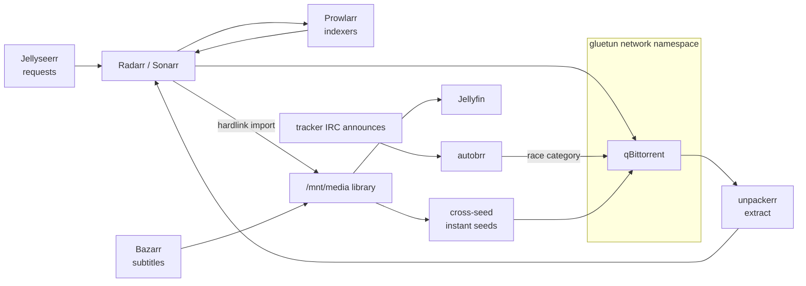

# Media pipeline

Request a movie or show and it downloads, gets renamed and shows up in Jellyfin on its
own. The torrent client can only reach the internet through a VPN.

**Runs on:** noahlab ([the boxes](../../README.md#the-boxes)) · **Reachable at:** `request.milkhaus.net` (requests) and `join.milkhaus.net` (invites); everything else is Tailscale/LAN only · **Talks to:** [Jellyfin](../jellyfin/)

## How it works

Thirteen containers in one compose file. Jellyseerr takes requests, Sonarr (shows) and
Radarr (movies) find releases through Prowlarr, and qBittorrent downloads them. jfa-go
handles Jellyfin invites.

- **VPN.** qBittorrent has no network of its own; it shares gluetun's (a VPN container).
  If the tunnel is down, torrents just stop instead of falling back to my home
  connection.
- **Quality.** [Recyclarr](recyclarr/recyclarr.yml) syncs the
  [TRaSH Guides](https://trash-guides.info/) quality presets every day and owns one
  profile, "1080p Efficient". Small x265 1080p releases score +200 because the drive is
  14 TB (TRaSH scores them way down by default), and season packs score higher still.
  New releases wait 60 minutes for a better one unless they already score 200.
- **Seeding.** On my private tracker I also race: autobrr watches the tracker's announce
  channel and grabs brand-new uploads in the first minutes, which builds ratio. The
  tracker hands out a hit-and-run (a strike) if you don't seed for 10 days after a
  download.

| What | Rule | Done by |
|---|---|---|
| Public trackers | delete at ratio 1.0 or after 24 h | cleanuparr |
| Private tracker | seed forever | cleanuparr exemption |
| Races (`race` category) | ratio 10 or 14 days per torrent, at most 15 grabs a week, 30 GB each | autobrr filter + qBittorrent |
| Cleaning up races | only after 10 days of real seeding, and only once it's dead, stopped, or 21 days old; whole category capped at 500 GB | [`race-reaper.py`](scripts/race-reaper.py), hourly |

cross-seed finds tracker matches for stuff already on the drive and seeds them right
away, hardlinked, so they cost no extra space.

## Worth knowing

- qBittorrent's queueing stays off. A queued torrent stops checking in with the tracker,
  and the tracker counts that as not seeding
  ([what happened](../../docs/incidents.md#queued-torrents-counted-as-hit-and-runs)).
- gluetun's health check uses IP addresses and plain DNS. With hostnames it restarted
  the tunnel all night
  ([what happened](../../docs/incidents.md#the-vpn-restarted-itself-579-times-in-a-night)).
- Don't run `docker image prune -a` here. Several images are local builds with nowhere to
  re-pull them from. Plain `image prune` and `builder prune` are fine.
- Downloads and the library are one filesystem so imports are hardlinks
  ([why](../../docs/architecture.md#storage)). The qBittorrent password is stored in
  Sonarr, Radarr, cleanuparr, autobrr and cross-seed too, so change it in all of them.

## Files

| File | What it is |
|---|---|
| [`docker-compose.yml`](docker-compose.yml) | All 13 services |
| [`.env.example`](.env.example) | The secrets the compose file expects |
| [`recyclarr/`](recyclarr/) | Quality profile config, plus an example secrets file |
| [`scripts/race-reaper.py`](scripts/race-reaper.py) | Deletes finished races without causing hit-and-runs. `--selftest` runs its tests |
| [`scripts/media-dedup.py`](scripts/media-dedup.py) | Keeps one copy of each movie or episode. Duplicates go to a dated quarantine with a restore list, never straight to delete |
